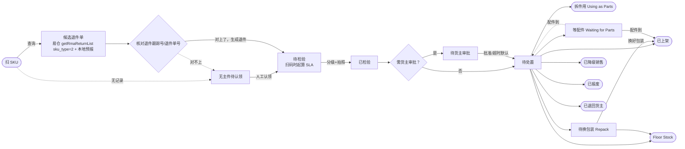
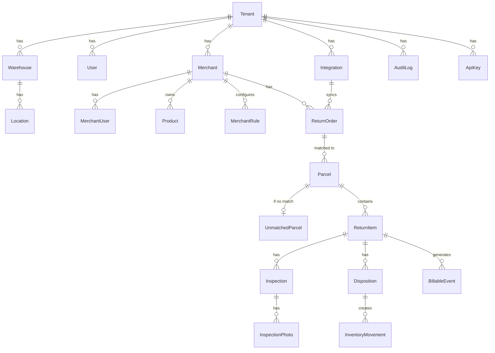

# RMA 3PL 退件系统：功能清单与数据库设计

> 状态：所有设计问题已确认，可以开始第一个功能 PR。
> 仓库：https://github.com/hicola888/rma-app（apps/web、apps/api、packages/db）
> 本文不包含任何密钥或凭证值。
> 订单补件和配件入库见 [parts-replenishment.md](parts-replenishment.md)。

## 目录

1. 总览与分阶段
2. MVP 功能清单
3. 开发顺序（每个功能一个 PR）
4. 退件状态流
5. 数据模型
6. 易仓对接
7. 现有 Retool 流程对照（含 RTN_RECORD 字段对照）
8. 已确认的决定
9. 订单补件与配件入库见 [parts-replenishment.md](parts-replenishment.md)

---

## 1. 总览与分阶段

| 阶段          | 内容                                                                                                                                                      | 目标                                             |
| ------------- | --------------------------------------------------------------------------------------------------------------------------------------------------------- | ------------------------------------------------ |
| 第 1 阶段 MVP | 租户/仓库/用户、货主与 SKU、预报、易仓对接、扫 SKU 收货 + 无主件、按 SOP 检验拍照、处置上架 + 审批、计费事件记录、订单补件、配件入库                      | 能在真实仓库跑起来，同时开始积累计费数据         |
| 第 2 阶段     | 货主门户（进度、照片、异议、审批）、邮件/Webhook 通知、费率表（RateCard）与账单导出、内部报表、故障率报表、对多种外部系统的通用 API 同步（含原 WMS 回写） | 货主自助，开始收费，并在退件流程跑通后再对外同步 |
| 第 3 阶段     | Shopify 等店铺集成、承运商退货标签、客户自助退货页、SLA 看板、公开 API                                                                                    | 对接外部系统，扩大规模                           |

**为什么这样设计**：计费和门户工作量大，放到第 2 阶段；但计费需要的数据（BillableEvent）从第 1 天就记录，到时不用补录。

### 技术栈

- 前端：Next.js + TypeScript + Tailwind，PWA（apps/web）
- 后端：NestJS REST API，Swagger 文档，API Key 鉴权（apps/api）
- 数据库：PostgreSQL + Prisma 7（packages/db）；本地 Docker（端口 15432），云端 Supabase（悉尼）
- 登录：Clerk（Organization = 3PL 租户）
- 照片：Cloudflare R2 私有桶 + 短时预签名链接

---

## 2. MVP 功能清单

| 模块         | 功能                                                                                                                                       | 说明                                                     |
| ------------ | ------------------------------------------------------------------------------------------------------------------------------------------ | -------------------------------------------------------- |
| 1 租户与权限 | 注册 3PL、仓库、库位（含隔离区）、员工、角色                                                                                               | 管理员/主管/作业员；员工可限定负责的货主                 |
| 2 货主与 SKU | 货主管理、SKU 主数据、CSV 导入                                                                                                             | SKU 按货主区分，多条码                                   |
| 2 货主 SOP   | 分级、原因码、处置矩阵、必拍清单、隔离天数                                                                                                 | 租户默认 + 货主覆盖                                      |
| 3 退货预报   | 手动创建、CSV 导入（按货主）                                                                                                               | 扫码时用来匹配                                           |
| 3 易仓对接   | 保存易仓凭证；按 SKU、退件跟踪号或退件单号查易仓退件单                                                                                     | 查到的结果存进 ReturnOrder（source = eccang）            |
| 4 扫码收货   | 先扫 SKU → 调易仓 `getRmaReturnList`（sku_type=2 精确）+ 本地预报 → 候选列表 → 扫退件跟踪号（type 11）或退件单号（type 10）核对 → 生成退件 | 扫码枪模拟键盘：输入框自动聚焦，回车提交                 |
| 4 无主件     | 记录线索 + 拍照、系统推荐货主、人工认领                                                                                                    | 认领前不计入任何库存                                     |
| 5 检验       | 按货主 SOP 选等级、原因，拍必拍照片                                                                                                        | 照片带哈希、时间、操作人，不可改                         |
| 6 处置与上架 | 按处置矩阵给建议，执行处置                                                                                                                 | 需审批的进入“待货主审批”，阶段 1 由员工代录              |
| 7 计费事件   | 收货、检验、拍照、处置时自动写入 BillableEvent                                                                                             | 只记录不出账单                                           |
| 8 订单补件   | 新建补件单、按已拆箱子和退件找配件、拆新补件、等供应商                                                                                     | MVP。状态里「已处理」和「已发出」分开                    |
| 8 配件入库   | 工厂直发和 RMA 拆出进同一个配件库存，领用时按同样方式扣减                                                                                  | MVP。见 [parts-replenishment.md](parts-replenishment.md) |

**为什么这样设计**：PDA 先做“扫码枪当键盘”的方式，大部分安卓 PDA 不用装 App，打开浏览器就能用；手机摄像头扫码作为备用。

---

## 3. 开发顺序（每个功能一个 PR）

PR #1–#3 已合并（项目骨架、本地端口 15432、Supabase 配置）。

| PR    | 内容                                            | 说明                                                                                                 |
| ----- | ----------------------------------------------- | ---------------------------------------------------------------------------------------------------- |
| PR 4  | 登录（Clerk）+ 租户 + 数据隔离（RLS）+ 隔离测试 | 跨租户、跨货主读不到数据的自动化测试一起做                                                           |
| PR 5  | 仓库、库位、员工与角色                          | 后台基础资料页面                                                                                     |
| PR 6  | 货主、SKU 主数据（含 CSV 导入）                 | 唯一键 (tenant_id, merchant_id, sku)                                                                 |
| PR 7  | 货主 SOP 配置                                   | 分级、原因码、处置矩阵、必拍清单                                                                     |
| PR 8  | 退货预报（手动 + CSV）                          |                                                                                                      |
| PR 9  | 易仓对接                                        | 加密存凭证、服务器端签名、按 SKU / 跟踪号 / 退件单号查退件单并缓存到 ReturnOrder；含签名函数单元测试 |
| PR 10 | PDA 扫 SKU 收货 + 计费事件框架                  | 候选退件单 → 核对单号 → 生成包裹和退件；开始写 BillableEvent                                         |
| PR 11 | 无主件队列与认领                                | 线索、推荐、人工确认、日志                                                                           |
| PR 12 | 检验 + 拍照（R2 存储、哈希）                    | 只增不改在数据库层强制                                                                               |
| PR 13 | 处置、审批、上架与库存流水                      |                                                                                                      |
| PR 14 | 订单补件                                        | MVP。已处理、已发出是两个状态；拆新补件号码用 REP 独立流水；快递单号记在单头                         |
| PR 15 | 配件入库                                        | MVP。工厂直发与 RMA 拆出进同一配件库存                                                               |

**为什么这样设计**：数据隔离是 3PL SaaS 最致命的安全点，以后补很痛苦，所以放在第一个功能 PR。每个 PR 小而完整，可以逐个审核、出问题单独撤回。

内部报表和故障率报表不在上面的 MVP 顺序里，放到第 2 阶段。WMS 回写也不在 MVP：退件流程端到端跑通之后，第 2 阶段再做成对多种外部系统的通用 API 同步。

---

## 4. 退件状态流

- 扫 SKU、候选退件单、核对单号是**收货步骤，不是状态**。
- 候选可能有多张（每页 50 条，超过会翻页取完）；只有一张时也必须扫单号确认，有多张时扫到的单号决定是哪一张。
- 核对成功时，同时生成 Parcel（外箱跟踪号）和 ReturnItem，扫码那一刻开始计 SLA。查不到或对不上就进无主件队列。
- 隔离区停放超期的件，按货主 SOP 的“超期处理”自动生成待处置任务。
- 进入最终状态（已上架 / Floor Stock / 拆件用 / 已降级销售 / 已报废 / 已退回货主）时，同时写入 InventoryMovement 和 BillableEvent。

**状态列表**：无主件待认领 / 待检验 / 已检验 / 待货主审批 / 待处置 / 待换包装（Repack）/ 等配件（Waiting for Parts）；最终：已上架 / Floor Stock / 拆件用（Using as Parts）/ 已降级销售 / 已报废 / 已退回货主。

**为什么这样设计**：先扫 SKU 是现有做法，系统照搬：SKU 缩小范围，单号做最终核对，避免把退件挂错单。状态按“件”跟踪，每次状态变化都写日志。

---

## 5. 数据模型

所有业务表都有 `tenantId`（PostgreSQL RLS 隔离）；货主级表另有 `merchantId`，货主用户的查询强制按 `merchantId` 过滤。

**只增不改的表**（数据库层禁止 UPDATE/DELETE，更正 = 新增一条记录）：Inspection、InspectionPhoto、InventoryMovement、BillableEvent、AuditLog。

**为什么这样设计**：货主质疑时拿得出完整证据；库存不存“当前数量”，由流水累加，账永远对得上。

### Tenant — 3PL 公司（付费客户）｜顶层

| 字段      | 类型      | 说明     |
| --------- | --------- | -------- |
| id        | uuid      | 主键     |
| name      | text      | 公司名   |
| plan      | text      | 订阅套餐 |
| createdAt | timestamp |          |

### Warehouse — 仓库｜租户级

| 字段        | 类型 | 说明               |
| ----------- | ---- | ------------------ |
| id          | uuid |                    |
| tenantId    | uuid | RLS 隔离           |
| code / name | text | 仓库代码租户内唯一 |
| timezone    | text | 算 SLA 用          |

### Location — 库位｜租户级

库位可多个货主共用，数量在库存流水里分账。

| 字段                   | 类型 | 说明                            |
| ---------------------- | ---- | ------------------------------- |
| id                     | uuid |                                 |
| tenantId / warehouseId | uuid |                                 |
| code                   | text | 如 R-01-02                      |
| type                   | enum | 正常 / 隔离区 / 报废区 / 待退回 |

### User — 3PL 员工｜租户级

| 字段          | 类型   | 说明                   |
| ------------- | ------ | ---------------------- |
| id            | uuid   |                        |
| tenantId      | uuid   |                        |
| authId        | text   | Clerk 用户 ID          |
| role          | enum   | 管理员 / 主管 / 作业员 |
| merchantScope | uuid[] | 空 = 全部货主          |

### Merchant — 货主｜租户级

| 字段        | 类型 | 说明               |
| ----------- | ---- | ------------------ |
| id          | uuid |                    |
| tenantId    | uuid |                    |
| code / name | text | 货主代码租户内唯一 |
| status      | enum | 启用 / 停用        |

### MerchantUser — 货主账号｜货主级

阶段 2 门户用，表先建。

| 字段                  | 类型 | 说明                   |
| --------------------- | ---- | ---------------------- |
| id                    | uuid |                        |
| tenantId / merchantId | uuid | 强制按 merchantId 过滤 |
| authId / email        | text |                        |
| role                  | enum | 查看 / 审批            |

### Product — 货主 SKU｜货主级

不同货主 SKU 会重码，所以唯一键带货主。

| 字段                  | 类型   | 说明                             |
| --------------------- | ------ | -------------------------------- |
| id                    | uuid   |                                  |
| tenantId / merchantId | uuid   |                                  |
| sku                   | text   | 唯一 (tenantId, merchantId, sku) |
| barcodes              | text[] | EAN/UPC 等多个条码               |
| name / imageUrl       | text   |                                  |

### MerchantRule — 货主 SOP｜货主级（可为租户默认）

merchantId 为空 = 租户默认；货主有自己的就覆盖。

| 字段                                | 类型       | 说明                                                                                                                                |
| ----------------------------------- | ---------- | ----------------------------------------------------------------------------------------------------------------------------------- |
| tenantId / merchantId?              | uuid       | merchantId 空表示默认                                                                                                               |
| grades                              | json       | 租户默认：A 全新未拆封；B 已拆封、产品完好、配件齐全（A、B 为建议默认，可调整）；C 包装破损、产品完好；D 产品有瑕疵。每个货主可覆盖 |
| reasonCodes                         | json       | 退货原因码                                                                                                                          |
| dispositionMatrix                   | json       | 等级 → 处置，含“需货主审批”开关                                                                                                     |
| requiredPhotos                      | json       | 必拍清单（外箱、面单、商品、瑕疵…）                                                                                                 |
| quarantineDays / overdueAction      | int / enum | 隔离天数和超期处理                                                                                                                  |
| approvalTimeoutDays / defaultAction | int / enum | 审批超时默认处置                                                                                                                    |
| slaHours                            | int        | 如 48                                                                                                                               |

### Integration — 外部系统连接（易仓）｜租户级

用 3PL 自己的易仓账号，所有货主共用，凭证加密保存。

| 字段                            | 类型                    | 说明                                                                  |
| ------------------------------- | ----------------------- | --------------------------------------------------------------------- |
| id                              | uuid                    |                                                                       |
| tenantId / merchantId?          | uuid                    | 易仓为租户级（merchantId 为空）；以后店铺集成可按货主                 |
| provider                        | enum                    | eccang（以后 shopify 等）。对外回写不在 MVP，第 2 阶段做通用 API 同步 |
| credentials                     | 加密 json               | app_key、app_secret、service_id 等（只存密文）                        |
| status / lastSyncAt / lastError | enum / timestamp / text | 连接健康状况                                                          |

### ReturnOrder — 退货预报 RMA/ASN｜货主级

本地预报和从易仓拉来的退件单都存这里，扫码时一起匹配。

| 字段                                | 类型              | 说明                                                   |
| ----------------------------------- | ----------------- | ------------------------------------------------------ |
| id                                  | uuid              |                                                        |
| tenantId / merchantId / warehouseId | uuid              |                                                        |
| rmaNo / trackingNo                  | text              | 扫 SKU 后用来核对                                      |
| source                              | enum              | manual / csv / eccang                                  |
| integrationId? / externalId         | uuid / text       | 易仓退件单号 ro_code；唯一 (integrationId, externalId) |
| externalRaw / syncedAt              | json / timestamp  | 易仓原始数据和同步时间                                 |
| status                              | enum              | 已预报 / 部分到货 / 已到货 / 关闭                      |
| lines                               | → ReturnOrderLine | SKU、预期数量                                          |

### Parcel — 到仓包裹｜货主级（认领后）

| 字段                    | 类型             | 说明       |
| ----------------------- | ---------------- | ---------- |
| id                      | uuid             |            |
| tenantId / warehouseId  | uuid             |            |
| merchantId?             | uuid             | 认领前为空 |
| returnOrderId?          | uuid             |            |
| trackingNo              | text             | 外箱跟踪号 |
| receivedAt / receivedBy | timestamp / uuid | SLA 起点   |
| status                  | enum             | 见状态流   |

### UnmatchedParcel — 无主件｜租户级

认领前不属于任何货主，也不进任何库存。

| 字段                                      | 类型             | 说明                           |
| ----------------------------------------- | ---------------- | ------------------------------ |
| parcelId                                  | uuid             |                                |
| clues                                     | json             | 面单号、发件人、内件条码、备注 |
| suggestions                               | json             | 系统推荐货主及匹配原因         |
| claimedMerchantId / claimedBy / claimedAt | uuid / timestamp | 人工确认                       |
| status                                    | enum             | 待认领 / 已认领 / 超期处理     |

### ReturnItem — 退件明细（单件）｜货主级

| 字段                             | 类型 | 说明                                    |
| -------------------------------- | ---- | --------------------------------------- |
| id                               | uuid |                                         |
| code                             | text | 每件唯一编码（对应旧 WH_REF），打标签用 |
| tenantId / merchantId / parcelId | uuid |                                         |
| productId?                       | uuid | 未知 SKU 可后补                         |
| status                           | enum | 见状态流                                |
| currentLocationId                | uuid |                                         |

### Inspection — 检验记录｜货主级 · 只增不改

| 字段                      | 类型             | 说明             |
| ------------------------- | ---------------- | ---------------- |
| id                        | uuid             |                  |
| returnItemId / merchantId | uuid             |                  |
| grade / reasonCode        | text             | 来自该货主 SOP   |
| notes                     | text             |                  |
| inspectedBy / inspectedAt | uuid / timestamp |                  |
| supersedesId?             | uuid             | 更正时指向旧记录 |

### InspectionPhoto — 检验照片｜货主级 · 只增不改

| 字段                      | 类型             | 说明                                      |
| ------------------------- | ---------------- | ----------------------------------------- |
| id                        | uuid             |                                           |
| inspectionId / merchantId | uuid             |                                           |
| photoType                 | text             | 对应必拍清单项                            |
| storageKey                | text             | R2 私有桶中的路径；查看时发短时预签名链接 |
| sha256                    | text             | 文件哈希                                  |
| takenBy / takenAt         | uuid / timestamp |                                           |

### Disposition — 处置｜货主级

| 字段                                               | 类型                    | 说明                                                                                                                            |
| -------------------------------------------------- | ----------------------- | ------------------------------------------------------------------------------------------------------------------------------- |
| id                                                 | uuid                    |                                                                                                                                 |
| returnItemId / merchantId                          | uuid                    |                                                                                                                                 |
| action                                             | enum                    | 重新上架 / Floor Stock / 拆件用 / 换包装（Repack）/ 翻新（维修）/ 降级销售 / 报废 / 退回货主 / 其他；换包装和翻新是两种不同操作 |
| requiresApproval                                   | bool                    |                                                                                                                                 |
| approvalStatus / approvedBy / approvedAt / comment | enum / text / timestamp | 阶段 1 由员工代录                                                                                                               |
| executedBy / executedAt                            | uuid / timestamp        |                                                                                                                                 |

### InventoryMovement — 库存流水｜货主级 · 只增不改

库存 = 流水累加，按货主分账，库位可共用。

| 字段                              | 类型             | 说明                                                                                         |
| --------------------------------- | ---------------- | -------------------------------------------------------------------------------------------- |
| id                                | uuid             |                                                                                              |
| tenantId / merchantId / productId | uuid             |                                                                                              |
| fromLocationId? / toLocationId?   | uuid             |                                                                                              |
| qty                               | int              | 正负数                                                                                       |
| type                              | enum             | 收货 / 上架 / 移库 / 转 Floor Stock / 拆件用（Using as Parts）/ 转降级销售 / 报废 / 退回货主 |
| refType / refId                   | text / uuid      | 来源单据                                                                                     |
| by / at                           | uuid / timestamp |                                                                                              |

### BillableEvent — 计费事件｜货主级 · 只增不改

只记原始事实，以后任何计价方式都能算。

| 字段                                | 类型             | 说明                                    |
| ----------------------------------- | ---------------- | --------------------------------------- |
| id                                  | uuid             |                                         |
| tenantId / merchantId / warehouseId | uuid             |                                         |
| eventType                           | enum             | 收货、检验、拍照、贴标、处置、存储天数… |
| unitQty / parcelQty                 | int              |                                         |
| refType / refId                     | text / uuid      |                                         |
| by / occurredAt                     | uuid / timestamp |                                         |

### AuditLog — 操作日志｜租户级 · 只增不改

| 字段                       | 类型        | 说明                     |
| -------------------------- | ----------- | ------------------------ |
| id                         | uuid        |                          |
| tenantId / merchantId?     | uuid        |                          |
| actorId / actorType        | uuid / enum | 员工 / 货主 / 系统 / API |
| action / entity / entityId | text        |                          |
| before / after             | json        |                          |
| at                         | timestamp   |                          |

### ApiKey — API 密钥｜租户级

对外 API 鉴权；只存哈希，不存明文。

| 字段                   | 类型               | 说明 |
| ---------------------- | ------------------ | ---- |
| id                     | uuid               |      |
| tenantId / merchantId? | uuid               |      |
| keyHash / prefix       | text               |      |
| scopes / revokedAt     | text[] / timestamp |      |

---

## 6. 易仓对接

| 项目           | 内容                                                                                                                                                                                                        | 状态     |
| -------------- | ----------------------------------------------------------------------------------------------------------------------------------------------------------------------------------------------------------- | -------- |
| 开放平台       | https://open.eccang.com ，在易仓后台“应用管理”创建应用并授权                                                                                                                                                | 已有账号 |
| 系统           | 易仓 ERP（现有 Retool 应用经 Cloudflare 代理调用易仓 ERP 开放接口）                                                                                                                                         | 已确认   |
| 鉴权方式       | AES 签名（MD5 为备选），只在服务器端做                                                                                                                                                                      | 已确认   |
| 退件查询接口   | `getRmaReturnList`，version `V1.0.0`，biz_content 带 `page`、`page_size`（50）                                                                                                                              | 已确认   |
| 按 SKU 查      | `sku_type`：1 = 模糊，2 = 精确；`sku_str` = SKU。收货用精确（2）                                                                                                                                            | 已确认   |
| 按单号查       | `type` + `code`：0 订单号、6 仓库单号、1 参考编号、2 跟踪号、10 退件单号、11 退件跟踪号                                                                                                                     | 已确认   |
| 分页与多条结果 | 每页 50 条，必须翻页取完（现有应用只取第 1 页）；同一 SKU 常有多张退件单，列出候选，靠退件跟踪号/退件单号锁定唯一一张                                                                                       | 设计约定 |
| 返回字段       | `data.biz_content.data[]`：`ro_code` → 退件单号、`reason`、`note` → 备注、`order_code`、`tracking_no`、`warehouse_order_code`；`product_sku` 与 `product_sku_qty` 是逗号分隔字符串，按位置配对成 SKU + 数量 | 已确认   |
| 其他接口       | `getRmaReason`（原因下拉）、`getOrders`（按订单号）、`getOrderInfo`（按 `warehouse_order_code`）、`getRmaRefundList`（退款，阶段 2+）                                                                       | 已确认   |

### 签名与通用参数（已确认）

- **请求地址**：`POST http://openapi-web.eccang.com/openApi/api/unity`（application/json），所有接口共用一个地址。
- **通用参数**：`app_key`、`service_id`、`nonce_str`、`interface_method`、`biz_content`（JSON 字符串）、`sign_type`、`charset`=UTF-8、`timestamp`（毫秒）、`version`、`sign`。
- **AES 签名（我们用）**：去掉 `sign` 和空值，其余参数按名字字母排序，拼成 `k=v` 用 `&` 连接；用 app_secret 做密钥，AES/CBC/PKCS7Padding，IV `1234500000054321`，UTF-8。输出编码（Base64 或十六进制）在 PR 9 里对照 Retool 现有实现测试确认。
- **MD5 签名（备选）**：同样拼接后在末尾接上 app_secret，取 32 位小写 MD5。
- **时间戳**：1 分钟内有效且只能用一次（`saas.api.error.code.0049` 签名过期）：每次请求重新签名，服务器时钟保持同步。
- **密钥保管**：只放服务器环境变量 / 加密的 Integration 记录，前端永远拿不到。
- **测试**：PR 9 包含签名函数的单元测试。

| 错误码                   | 给作业员看的中文提示               |
| ------------------------ | ---------------------------------- |
| common.error.code.0028   | 易仓验签失败，请联系管理员检查凭证 |
| saas.api.error.code.0049 | 签名过期，系统将自动重试           |
| saas.api.error.code.0016 | 记录不存在或已删除                 |
| saas.api.error.code.0021 | 易仓应用未审核通过                 |
| saas.api.error.code.0032 | 该接口未授权                       |
| saas.api.error.code.0024 | 易仓暂不支持该接口                 |
| saas.api.error.code.0013 | 授权信息不完整                     |
| common.error.code.9999   | 易仓系统异常，请稍后再试           |

**为什么这样设计**：易仓做成独立的“适配器”：收货页面只问“这个 SKU 有哪些退件单”，不关心背后是哪个系统。查到的单存进本地，易仓偶尔连不上也能继续收货；以后接 Shopify 也只是多写一个适配器。

---

## 7. 现有 Retool 流程对照

| 保留的做法                                              | 在新系统里                                                        |
| ------------------------------------------------------- | ----------------------------------------------------------------- |
| 每件一个 WH_REF，打两张 50×30mm 标签（条码 + 处置标签） | ReturnItem.code + 标签打印，可重打                                |
| 无 RMA 用 `MANUAL-YYYYMMDD-xxxx` 编号，进客服待核查     | 无主件队列 + 认领                                                 |
| 处置结果回写 Inbound / FloorStock                       | 不在 MVP。退件流程跑通后，第 2 阶段做成通用 API 同步（见第 8 节） |
| 分段报错、防重复提交                                    | 保留，并做到数据库层                                              |

| 要修的问题                   | 新做法                          |
| ---------------------------- | ------------------------------- |
| 同一退件可重复登记           | 按 (易仓单号, SKU) 查重         |
| SKU、数量不对照 RMA 校验     | 只能选 RMA 上的 SKU，数量不能超 |
| 扫到的单号不核对选中的记录   | 必须扫单号并与候选比对          |
| 登记和处置分两步，失败留半截 | 一个事务 + 状态机，失败可重试   |
| 没有照片、没有结构化检验     | 按货主 SOP 分级、原因、必拍照片 |
| 没有退款闭环                 | 阶段 2+ 接 `getRmaRefundList`   |
| 编辑无日志、备注被覆盖       | AuditLog，只增不改              |
| 易仓密钥写在前端             | 加密存在服务器，前端拿不到      |

### 旧表 RTN_RECORD 字段对照

| 旧字段                        | 新模型                                                        |
| ----------------------------- | ------------------------------------------------------------- |
| WH_REF                        | ReturnItem.code                                               |
| RTN_REF                       | ReturnOrder.externalId（易仓 ro_code；MANUAL- 开头 = 无主件） |
| RMA_TRACKING                  | ReturnOrder.trackingNo / Parcel.trackingNo                    |
| RMA_Platform                  | ReturnOrder 平台字段                                          |
| SKU / QTY / BATCH             | ReturnItem.productId / 数量 / 批次                            |
| REASON / REMARK               | Inspection.reasonCode / notes                                 |
| WH_PROCESS / PROCESS_REMARK   | Disposition.action / comment                                  |
| PROCESSED                     | 无主件认领状态                                                |
| RECEIVE_DATE / APPUSER / DATE | Parcel.receivedAt / receivedBy、AuditLog                      |

以后可以把旧记录一次性导入新系统，保留历史查询；先不做，上线前再定。

**为什么这样设计**：现有流程已经在真实仓库跑通，好用的习惯照搬，员工上手快；只改会出错、查不清的地方。

---

## 8. 已确认的决定

1. **登录服务：Clerk** — 自带 Organization（对应 3PL 租户）、邀请成员、验证码登录。
2. **照片存储：Cloudflare R2** — 私有存储桶；API 先检查租户/货主权限，再发放短时有效的预签名链接，照片不公开。
3. **状态名称**（可能再微调）— 无主件待认领 / 待检验 / 已检验 / 待货主审批 / 待处置 / 待换包装（Repack）/ 等配件（Waiting for Parts）；最终：已上架 / Floor Stock / 拆件用（Using as Parts）/ 已降级销售 / 已报废 / 已退回货主。
4. **处置类型** — 重新上架 / Floor Stock / 拆件用 / 换包装（Repack）/ 翻新（维修）/ 降级销售 / 报废 / 退回货主 / 其他。换包装和翻新是两种不同操作。不需要转 B2B、退供应商、捐赠。
5. **默认等级**（租户默认，每个货主可覆盖）— A 全新未拆封；B 已拆封、产品完好、配件齐全（A、B 为建议默认，可调整）；C 包装破损、产品完好；D 产品有瑕疵。
6. **收货流程** — 先扫 SKU，再核对退件跟踪号或退件单号；目前只有一个仓库使用。
7. **易仓账号** — 3PL 自己的一个账号，租户级集成，所有货主共用；已有在 Retool 中使用的凭证和签名文档。
8. **库存** — 新系统自己的库存流水和退件处置是准账。WMS 回写不在 MVP。退件流程端到端跑通之后，第 2 阶段再做成对多种外部系统的通用 API 同步。

2026-11-10 补充确认：

9. **订单补件、配件入库都在 MVP。** 设计见 [parts-replenishment.md](parts-replenishment.md)。
10. **故障率报表不在 MVP。** 它和内部报表一起放到第 2 阶段。
11. **补件单状态** — 「已处理」和「已发出」是两个状态。
12. **拆新补件号码** — 前缀 `REP`，例如 `REP000123`。用自己的流水，不跟 `ReturnItem.code` 共用。
13. **快递单号** — 一张补件单一个，记在 `PartsOrder` 单头，不按行记。

其他已确认：不同货主 SKU 会重码（唯一键带 merchant_id）；无主件认领综合使用全部线索（面单、发件人、内件 SKU、人工比对）；部分货主要求处置前审批；计费模式未定，先记录 BillableEvent 原始事实。
