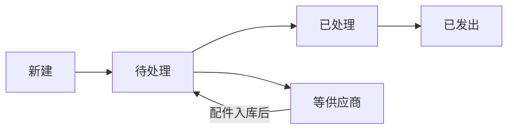

# 订单补件与配件入库

> 状态：设计稿，用来替换现在的 Retool 补件应用。还没有写代码。订单补件和配件入库都在 MVP（2026-11-10 确认）。
> 相关文档：[docs/design.md](design.md) 里的退件、Disposition（处置）和 InventoryMovement（库存流水）。
> 本文不包含任何密钥或凭证值。

这份设计覆盖两件事：

- **订单补件**：客户订单缺配件时，仓库从已拆的货、退件，或供应商那里找出配件并发出。
- **配件入库**：配件进入配件库存。来源只有两种：工厂直发，或从 RMA 退件上拆下来。

两种来源进同一个配件库存。领用时按同样的方式扣减。

## 现在的 Retool 在做什么

现有应用有三个页签：新建补件、未处理补件、已处理补件。

新建时要填：

| 现在的字段      | 含义           |
| --------------- | -------------- |
| Order Reference | 平台订单号     |
| SKU             | 可多选         |
| Product Batch   | 产品批次       |
| Platform        | 平台           |
| Reason          | 补件原因       |
| Parts           | 需要哪些配件   |
| Remark          | 备注           |
| 照片            | 订单或配件照片 |

处理界面会显示拣货库位和库存。每一行有：

- 一个输入框，填写退件号码或拆新补件号码
- SKU、配件说明、批次
- 三个来源按钮：退件、拆新补件、供应商补件

点 `+` 可以再加一行配件。

## 状态

页签和状态的对应：新建补件 = 新建，未处理补件 = 待处理。旧的「已处理补件」在新系统里分成两个状态：已处理、已发出（2026-11-10 确认，两者分开）。等供应商是处理过程中的等待，不是单独页签。

- **新建**：单已保存，还没交给仓库处理。
- **待处理**：仓库要找配件。来源可以是退件、拆新，或等供应商。
- **等供应商**：这一单里有配件要等工厂或供应商寄来。入库之后回到待处理，再继续找齐。
- **已处理**：每一行配件都已标明从哪里拿走，库存已经扣过。此时还没有寄出。
- **已发出**：补件已经寄出。和「已处理」是两个状态。一张补件单只有一个快递单号，记在单头 `PartsOrder.trackingNo`，不按行记。

## 补件怎么找配件

按下面的顺序做。

1. 先在**已经拆开的箱子**里找这个 SKU。
2. 看这台已拆机器的历史：配件还在里面，就从这里拿；已经没有了，就再拆一台新的。
3. 每台新拆开的机器给一个号码，叫拆新补件号码。前缀是 `REP`，用自己的流水，例如 `REP000123`。这套号码不跟 `ReturnItem.code` 共用。同时记下推荐号码和来源，用来区分「系统建议用某一台 RMA 退件」和「这次新拆开的机器」。
4. 记下产品批次。同一个 SKU，不同批次的配件可能不一样，不能混用。
5. 按 SKU 汇总用了多少配件，通知工厂或 3PL 的客户（Merchant，货主）补货。从退件上拆下来、还能再卖的配件，送回去重新销售。
6. 把 SKU 和配件资料登记进主数据，后面才能按料号查库存。
7. 工厂直接寄来的、经常损坏的配件，也作为入库记下来，不一定先挂在某一张订单上。
8. 快递单号一张补件单只记一个，放在单头 `PartsOrder.trackingNo`，不放在明细行上，方便平台追踪。
9. 新拆开一台机器，这个 SKU 的成品库存减 1。写一条 `InventoryMovement`，类型为 **拆件出库**。
10. 和现有退件流程共用拆件记录：处置类型「拆件用（Using as Parts）」和补件写入同一份 `DisassemblyRecord`。退件号码仍用 `ReturnItem.code`。拆新补件号码用 `REP` 独立流水。给工厂或货主看的用量汇总，每个 SKU 一行。

### 三个来源按钮

| 按钮       | 从哪里拿                                              | 要填的号码                           | 库存                                   |
| ---------- | ----------------------------------------------------- | ------------------------------------ | -------------------------------------- |
| 退件       | 已经在库的退件，优先是处置为「拆件用」的 `ReturnItem` | 退件号码，即 `ReturnItem.code`       | 只扣配件库存，不再把成品减 1           |
| 拆新补件   | 拆开一台还没拆过的机器                                | 新生成的拆新补件号码，如 `REP000123` | 成品库存减 1（拆件出库），再扣配件库存 |
| 供应商补件 | 工厂或供应商寄来的配件                                | 可以先空着，入库后再关联             | 等配件入库后再扣配件库存               |

处理界面上的拣货库位和库存：成品看这台机器所在库位和该 SKU 的成品库存；配件看 `PartInventory` 里这个料号、这个批次的数量。

## 表

每张业务表都有 `tenantId` 和 `merchantId`（数据库列名 `tenant_id`、`merchant_id`）。用 PostgreSQL RLS 按租户隔离，货主用户的查询还要按 `merchantId` 过滤。

配件流水 `PartMovement` 和成品流水 `InventoryMovement` 一样，只增不改。改错就再记一条相反数量的流水，不修改旧行。

### PartsOrder — 补件单

对应 Retool 的一整张补件单。

| 字段                  | 类型             | 说明                                                   |
| --------------------- | ---------------- | ------------------------------------------------------ |
| id                    | uuid             | 主键                                                   |
| tenantId / merchantId | uuid             | 租户和货主                                             |
| warehouseId           | uuid             | 仓库                                                   |
| orderReference        | text             | Order Reference，平台订单号                            |
| platform              | text             | Platform                                               |
| reason                | text             | Reason，补件原因                                       |
| remark                | text             | Remark                                                 |
| trackingNo            | text             | 快递单号。一张单一个，只记在单头，不按行记。发出前可空 |
| status                | enum             | 新建 / 待处理 / 已处理 / 已发出 / 等供应商             |
| createdBy / createdAt | uuid / timestamp |                                                        |
| updatedAt             | timestamp        |                                                        |

照片不放在这张表里，单独放 `PartsOrderPhoto`（私有存储，规则和检验照片一样：先检查租户和货主，再给短时链接）。

### PartsOrderLine — 补件明细

点 `+` 增加的每一行。一张单可以有多行，也可以有多个 SKU。

| 字段                  | 类型       | 说明                                                |
| --------------------- | ---------- | --------------------------------------------------- |
| id                    | uuid       |                                                     |
| tenantId / merchantId | uuid       |                                                     |
| partsOrderId          | uuid       | 属于哪张补件单                                      |
| sku                   | text       | 这一行的 SKU                                        |
| productBatch          | text       | Product Batch，批次                                 |
| partId                | uuid       | 指向 `Part`。主数据还没有时，可先只填说明           |
| partDescription       | text       | 配件说明，对应现在的 Parts                          |
| qty                   | int        | 数量，默认 1                                        |
| source                | enum       | 退件 / 拆新补件 / 供应商补件                        |
| sourceNumber          | text       | 退件号码或拆新补件号码                              |
| recommendationCode    | text       | 推荐号码。系统建议优先用的那台机器                  |
| recommendationSource  | enum       | RMA 推荐 / 新拆。用来区分建议来自退件，还是这次新拆 |
| returnItemId          | uuid，可空 | 来源是退件时，指向那一件 `ReturnItem`               |
| disassemblyRecordId   | uuid，可空 | 来源是拆新，或退件已经有拆件记录时                  |
| pickLocationId        | uuid，可空 | 拣货库位                                            |
| supplierName          | text，可空 | 来源是供应商时填写                                  |

### Part — 配件主数据

登记 SKU 和配件的对应关系。同一个 SKU 的不同批次可以对应不同配件，所以批次放在关系里，不把料号做成全局唯一。

| 字段                  | 类型       | 说明                                                  |
| --------------------- | ---------- | ----------------------------------------------------- |
| id                    | uuid       |                                                       |
| tenantId / merchantId | uuid       |                                                       |
| partNo                | text       | 料号。在同一个货主内唯一                              |
| name                  | text       | 配件名称                                              |
| sku                   | text       | 用在哪个 SKU 上                                       |
| productBatch          | text，可空 | 空表示这个 SKU 的各批次都适用；有值表示只适用于该批次 |
| description           | text       | 补充说明                                              |

### PartInventory — 配件当前库存

同一个配件库存，不按「工厂来的」和「退件拆的」分成两个仓库。数量按货主、料号、批次、库位分开记，避免不同批次的配件混在一起。

这一行的数量只能由写入 `PartMovement` 的同一笔操作更新，不能在界面上直接改。

| 字段                  | 类型       | 说明                     |
| --------------------- | ---------- | ------------------------ |
| id                    | uuid       |                          |
| tenantId / merchantId | uuid       |                          |
| partId                | uuid       |                          |
| productBatch          | text，可空 |                          |
| locationId            | uuid，可空 | 库位                     |
| qty                   | int        | 当前数量，由流水累加得到 |

### PartMovement — 配件流水｜只增不改

入库和出库都写在这里。出库数量为负数。

| 字段                  | 类型             | 说明                                       |
| --------------------- | ---------------- | ------------------------------------------ |
| id                    | uuid             |                                            |
| tenantId / merchantId | uuid             |                                            |
| partId                | uuid             |                                            |
| productBatch          | text，可空       |                                            |
| locationId            | uuid，可空       |                                            |
| qty                   | int              | 入库为正，出库为负                         |
| type                  | enum             | 入库 / 出库                                |
| source                | enum             | 工厂直发 / RMA拆出 / 补件领用              |
| partsOrderId          | uuid，可空       | 关联补件单。工厂直发、还没挂订单时可以空着 |
| partsOrderLineId      | uuid，可空       |                                            |
| refType / refId       | text / uuid      | 例如指向 `DisassemblyRecord`               |
| by / at               | uuid / timestamp |                                            |

### DisassemblyRecord — 拆件记录

退件处置里的「拆件用（Using as Parts）」和补件里的「拆新补件」写同一张表。这样一份历史就能看出这台机器被谁拆开、拆下了什么。

| 字段                  | 类型             | 说明                                                                                           |
| --------------------- | ---------------- | ---------------------------------------------------------------------------------------------- |
| id                    | uuid             |                                                                                                |
| tenantId / merchantId | uuid             |                                                                                                |
| sku                   | text             |                                                                                                |
| productBatch          | text             | 批次                                                                                           |
| unitCode              | text             | 新拆时为拆新补件号码，前缀 `REP`，独立流水，例如 `REP000123`。来源是退件时记 `ReturnItem.code` |
| origin                | enum             | RMA 推荐 / 新拆                                                                                |
| returnItemId          | uuid，可空       | 这台机器本来就是一件退件时填写                                                                 |
| dispositionId         | uuid，可空       | 由「拆件用」处置产生时填写                                                                     |
| partsRemaining        | json             | 这台已拆机器里还剩哪些配件。下次优先从这里拿                                                   |
| inventoryMovementId   | uuid，可空       | 新拆时那条「拆件出库」流水。从已在库的退件上拆，不再写第二条成品出库                           |
| openedBy / openedAt   | uuid / timestamp |                                                                                                |

给工厂或货主的用量汇总不按每台机器展开，按 SKU 合成一行（用了哪些料号、各多少）。明细仍留在 `DisassemblyRecord` 和 `PartMovement` 里。

### PartsOrderPhoto — 补件照片

| 字段                  | 类型             | 说明         |
| --------------------- | ---------------- | ------------ |
| id                    | uuid             |              |
| tenantId / merchantId | uuid             |              |
| partsOrderId          | uuid             |              |
| storageKey            | text             | 私有存储路径 |
| sha256                | text             | 文件哈希     |
| takenBy / takenAt     | uuid / timestamp |              |

## 和退件表怎么接

| 现有表              | 补件里怎么用                                                                                                                                                      |
| ------------------- | ----------------------------------------------------------------------------------------------------------------------------------------------------------------- |
| `ReturnItem`        | 来源是「退件」时，`PartsOrderLine.returnItemId` 指向这一件，号码用已有的 `ReturnItem.code`。新拆的机器不新建退件，拆新补件号码用 `REP` 独立流水，例如 `REP000123` |
| `Disposition`       | 处置为「拆件用（Using as Parts）」时写入或关联 `DisassemblyRecord`。补件再从这个记录上拿配件，不另做一套拆件历史                                                  |
| `InventoryMovement` | 只在新拆一台成品时写类型 **拆件出库**，数量 -1，`refType` 指向 `DisassemblyRecord`。从退件上拿配件不再减成品库存。建议在现有类型上增加「拆件出库」                |

配件本身的增减只进 `PartMovement`，不写进成品的 `InventoryMovement`。

## 配件入库

入库不分成两个库存。工厂直发和 RMA 拆出都增加 `PartInventory`，并追加一条 `PartMovement`（类型 = 入库）。

| 字段       | 记在哪里                                                                      | 说明                                         |
| ---------- | ----------------------------------------------------------------------------- | -------------------------------------------- |
| 料号       | `Part.partNo`                                                                 | 先有主数据，或入库时一并登记                 |
| 数量       | `PartMovement.qty`                                                            | 正数                                         |
| 来源       | `PartMovement.source`                                                         | 工厂直发，或 RMA拆出                         |
| 入库日期   | `PartMovement.at`                                                             |                                              |
| 关联补件单 | `PartMovement.partsOrderId`                                                   | 工厂先寄来、还没有订单时可以空着，之后再补上 |
| 供应商     | `PartsOrderLine.supplierName`，直发没有补件单时记在流水备注或后续的供应商字段 | 见文末未决问题                               |

出库（补件领用）也写 `PartMovement`，数量为负，`source` = 补件领用。扣减规则和入库是同一套：改的是同一个 `PartInventory` 数量。

经常损坏、工厂直接寄来的配件，可以先入库，不强制先有补件单。

## Retool 字段对照

| Retool                                         | 新系统                                                                         |
| ---------------------------------------------- | ------------------------------------------------------------------------------ |
| 新建补件 / 未处理补件 / 已处理补件             | `PartsOrder.status`：新建 / 待处理 / 已处理 / 已发出。已处理和已发出是两个状态 |
| Order Reference                                | `PartsOrder.orderReference`                                                    |
| SKU（多选）                                    | 每个 SKU 至少一行 `PartsOrderLine.sku`                                         |
| Product Batch                                  | `PartsOrderLine.productBatch`                                                  |
| Platform                                       | `PartsOrder.platform`                                                          |
| Reason                                         | `PartsOrder.reason`                                                            |
| Parts                                          | `PartsOrderLine.partDescription`，并关联 `Part`                                |
| Remark                                         | `PartsOrder.remark`                                                            |
| 照片                                           | `PartsOrderPhoto`                                                              |
| 拣货库位、库存                                 | `PartsOrderLine.pickLocationId`，以及成品库存和 `PartInventory.qty`            |
| 退件号码或拆新补件号码                         | `PartsOrderLine.sourceNumber`                                                  |
| 处理行上的 SKU、配件说明、批次                 | `PartsOrderLine` 的 `sku`、`partDescription`、`productBatch`                   |
| 按钮：退件 / 拆新补件 / 供应商补件             | `PartsOrderLine.source`                                                        |
| `+`                                            | 再插入一行 `PartsOrderLine`                                                    |
| 料号、数量、来源、入库日期、关联补件单、供应商 | 见上一节「配件入库」                                                           |

## 2026-11-10 已确认

- 订单补件和配件入库都在 MVP。
- 「已处理」和「已发出」是两个状态。
- 拆新补件号码前缀 `REP`，例如 `REP000123`，独立流水，不跟 `ReturnItem.code` 共用。
- 快递单号一张补件单一个，记在 `PartsOrder.trackingNo`。

## 未决问题

1. 推荐号码在作业员改选另一台机器之后，要不要保留原来的推荐，供以后对账？
2. 通知工厂或货主：用邮件、导出表格，还是先只在系统里给出按 SKU 的一行汇总？
3. 从退件拿配件时，这件退件是否必须已经处置为「拆件用」？
4. 拆下来还要再卖的配件，是回到成品库存（重新上架），还是只回到配件库存？
5. 工厂直发、当时没有补件单时，供应商名字记在哪一列？
6. 处理界面上的「库存」主要看成品，还是看配件？现在两个都保留。
